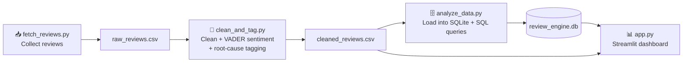

<div align="center">

# 🔍 Review Intelligence Engine

**An end-to-end Data Analytics, NLP and BI pipeline that turns raw app-store reviews into root-cause insights and churn-risk signals.**

[](https://review-intelligence-engine-kdzbheceffq8wocprpchaf.streamlit.app/)
[](#-tech-stack)
[](#-tech-stack)
[](#-tech-stack)
[](#-tech-stack)

[**🚀 Try the live dashboard**](https://review-intelligence-engine-kdzbheceffq8wocprpchaf.streamlit.app/) · [Pipeline](#-how-it-works) · [Quick start](#-quick-start) · [Project structure](#-project-structure)

</div>

---

## 📌 Overview

App-store reviews are full of signal, but reading thousands of them by hand doesn't scale. This project ingests **Swiggy Google Play Store reviews**, cleans and tags them with NLP, stores them in a SQL database, and surfaces the results in an interactive dashboard.

The goal is to answer practical business questions:

- 😡 **What are customers unhappy about?** (delivery, food quality, payments, app performance, ...)
- 📉 **Which issues carry the most churn risk?**
- 📆 **How is sentiment trending over time?**

> **Dataset:** 4,300+ Google Play Store reviews.

---

## ✨ Features

| | Feature | What it gives you |
|---|---|---|
| 📥 | **Automated ingestion** | Pulls reviews into a raw CSV with a single script |
| 🧹 | **Text cleaning** | Normalizes review text before analysis |
| 💬 | **Sentiment analysis** | VADER classifies each review as Positive, Neutral or Negative |
| 🏷️ | **Root-cause tagging** | Maps reviews to categories like Delivery, Food Quality, Payments and App Performance |
| 🗄️ | **SQL analysis** | SQLite queries for root-cause volume, star ratings and churn-risk indicators |
| 📊 | **Interactive dashboard** | Streamlit + Plotly app with sidebar filters, KPI cards, charts and daily trends |
| 🔎 | **Review explorer** | Sortable table of individual reviews |
| ⬇️ | **Filtered export** | Download the filtered view as CSV |

---

## 🧭 How it works



<details>
<summary><b>1️⃣ Ingestion</b> · <code>fetch_reviews.py</code></summary>
<br>
Collects Swiggy Google Play Store reviews and saves them to <code>raw_reviews.csv</code>.
</details>

<details>
<summary><b>2️⃣ Cleaning and NLP tagging</b> · <code>clean_and_tag.py</code></summary>
<br>
Cleans the review text, scores sentiment with <b>VADER</b> (Positive / Neutral / Negative), and maps each review to a root cause such as Delivery, Food Quality, Payments or App Performance. Output goes to <code>cleaned_reviews.csv</code>.
</details>

<details>
<summary><b>3️⃣ Storage and SQL analysis</b> · <code>analyze_data.py</code></summary>
<br>
Loads the tagged records into a SQLite database (<code>review_engine.db</code>) and runs queries on root-cause volume, star ratings and churn-risk indicators.
</details>

<details>
<summary><b>4️⃣ Dashboard</b> · <code>app.py</code></summary>
<br>
A Streamlit + Plotly app with sidebar filters, KPI cards, charts, daily trends, a sortable review explorer and filtered CSV export.
</details>

---

## 🛠️ Tech stack

| Area | Tools |
|---|---|
| Language | Python |
| Data handling | Pandas |
| Database | SQLite (`sqlite3`) |
| NLP | NLTK (VADER sentiment) |
| Visualization | Plotly Express |
| App framework | Streamlit |
| Version control | Git, GitHub |

---

## ⚡ Quick start

```bash
# 1. Clone the repository
git clone https://github.com/akshayanimma/review-intelligence-engine.git
cd review-intelligence-engine

# 2. Create and activate a virtual environment
python -m venv venv
source venv/bin/activate        # Windows: venv\Scripts\activate

# 3. Install dependencies
pip install -r requirements.txt

# 4. Run the pipeline (in order)
python fetch_reviews.py         # collect reviews -> raw_reviews.csv
python clean_and_tag.py         # clean + tag     -> cleaned_reviews.csv
python analyze_data.py          # load + query    -> review_engine.db

# 5. Launch the dashboard
streamlit run app.py
```

> 💡 The repository already includes `cleaned_reviews.csv` and `review_engine.db`, so you can skip straight to step 5 to explore the dashboard.

---

## 📁 Project structure

```
review-intelligence-engine/
├── fetch_reviews.py       # Ingestion: collect reviews
├── clean_and_tag.py       # Cleaning, VADER sentiment, root-cause tagging
├── analyze_data.py        # SQLite loading and SQL analysis
├── app.py                 # Streamlit + Plotly dashboard
├── raw_reviews.csv        # Raw collected reviews
├── cleaned_reviews.csv    # Cleaned and tagged reviews
├── review_engine.db       # SQLite database
├── requirements.txt       # Python dependencies
└── README.md
```

---

## 🔭 Possible next steps

- Add screenshots or a short GIF of the dashboard to this README
- Extend root-cause tagging beyond keyword rules, for example with a trained text classifier
- Add evaluation metrics for the tagging step against a hand-labelled sample

---

## 👩‍💻 Author

**Akshaya Nimma** · B.Sc. Computer Science and Machine Learning

[](https://github.com/akshayanimma)
[](https://linkedin.com/in/akshayanimma)

If you found this project useful, consider giving it a ⭐


   
