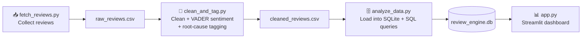

<div align="center">

# 🔍 Customer Support & Review Intelligence Engine

**An end-to-end Data Analytics, NLP and BI pipeline that turns raw app-store reviews into root-cause insights and churn-risk signals.**

[](https://review-intelligence-engine-kdzbheceffq8wocprpchaf.streamlit.app/)
[](#-tech-stack)
[](#-tech-stack)
[](#-tech-stack)
[](#-tech-stack)

[**🚀 Try the live dashboard**](https://review-intelligence-engine-kdzbheceffq8wocprpchaf.streamlit.app/) · [How it works](#-how-it-works) · [Quick start](#-quick-start) · [Project structure](#-project-structure)

</div>

---

## 📌 Overview

App-store reviews contain high-signal operational feedback, such as delivery delays, food quality and pricing concerns, payment and refund friction, and app bugs. Reading thousands of them by hand doesn't scale.

This project ingests **14,947 Swiggy Google Play Store reviews** (posted Sep to Nov 2026), cleans and tags them with NLP, stores them in a SQL database, and surfaces the results in an interactive dashboard to answer practical business questions:

- 😡 **What are customers unhappy about?**
- 📉 **Which complaints carry the most churn risk?**
- 📆 **How is sentiment trending over time?**

---

## 📈 Key findings

Results from the 14,947 cleaned reviews in `cleaned_reviews.csv`:

| Root cause | Reviews | Share of all reviews | Negative reviews | Avg rating |
|---|---|---|---|---|
| 🚚 Delivery & Logistics | 4,335 | 29.0% | 56.7% | 1.9 / 5 |
| 💳 Payment and Refunds | 1,354 | 9.1% | 60.7% | 1.8 / 5 |
| 🍔 Food Quality & Pricing | 1,398 | 9.4% | 37.1% | 2.8 / 5 |
| 🐞 App Performance & Bugs | 171 | 1.1% | 38.6% | 1.7 / 5 |
| 🎧 Customer Support & Other | 7,689 | 51.4% | 22.6% | 3.4 / 5 |

- **Delivery is the biggest pain point:** it is 29% of reviews but 43.9% of all negative-sentiment reviews.
- **Payments and refunds have the highest negative rate** (60.7%), with the lowest average rating among the larger categories.
- **Ratings are polarized:** 53.6% of reviews are 1 to 2 stars (50.3% are 1 star), 36.6% are 5 stars, and the overall average is 2.75 / 5.
- **Sentiment split:** 38.7% positive, 37.5% negative and 23.8% neutral.
- **Caveat:** tagging uses keyword rules, and "Customer Support & Other" is the catch-all for reviews that match no rule, so it holds about half the data.

---

## ✨ Features

| | Feature | What it gives you |
|---|---|---|
| 📥 | **Data ingestion** | Collects Google Play Store reviews into a raw CSV |
| 🧹 | **Cleaning** | Drops empty reviews, removes duplicates (by review ID and by text) and normalizes text |
| 💬 | **Sentiment analysis** | VADER compound score classifies each review as Positive, Neutral or Negative |
| 🏷️ | **Root-cause tagging** | Keyword rules map each review to one of five business root causes |
| 🗄️ | **SQL analysis** | SQLite queries for root-cause volume, star-rating distribution and churn-risk indicators |
| 🎛️ | **Interactive filters** | Filter by root cause, sentiment, star rating and keyword search |
| 📊 | **Dashboard** | KPI cards, sentiment and root-cause charts, and daily trend views |
| 🔎 | **Review explorer** | Sortable table of individual reviews |
| ⬇️ | **CSV export** | Download the filtered view |

---

## 🧭 How it works



<details>
<summary><b>1️⃣ Ingestion</b> · <code>fetch_reviews.py</code></summary>
<br>
Collects Google Play Store reviews and saves the raw dataset to <code>raw_reviews.csv</code>.
</details>

<details>
<summary><b>2️⃣ Cleaning and NLP tagging</b> · <code>clean_and_tag.py</code></summary>
<br>

**Cleaning:** removes reviews with no text, drops duplicates by review ID and by review content, and lower-cases the text.

**Sentiment:** each review gets a VADER compound score. A score of **+0.05 or higher** is *Positive*, **-0.05 or lower** is *Negative*, and anything in between is *Neutral*.

**Root causes:** rule-based keyword matching assigns one category per review:

| Root cause | Example keywords |
|---|---|
| 🚚 Delivery & Logistics | delivery, late, rider, delay, otp |
| 💳 Payment and Refunds | refund, charged, upi, payment, coupon |
| 🐞 App Performance & Bugs | crash, bug, slow, glitch, loading |
| 🍔 Food Quality & Pricing | taste, cold, quantity, packaging, expensive |
| 🎧 Customer Support & Other | everything that matches none of the above |

Rules are checked in the order shown, so a review that mentions several themes gets the first category that matches.

Output is saved to <code>cleaned_reviews.csv</code>.
</details>

<details>
<summary><b>3️⃣ Storage and SQL analysis</b> · <code>analyze_data.py</code></summary>
<br>
Loads the processed records into a SQLite database (<code>review_engine.db</code>) and runs queries on root-cause volume, star ratings and churn-risk indicators.
</details>

<details>
<summary><b>4️⃣ Interactive dashboard</b> · <code>app.py</code></summary>
<br>
A Streamlit + Plotly app with sidebar filters (root cause, sentiment, star rating, keyword search), KPI summary cards, sentiment and root-cause charts, daily trend views, a sortable review explorer and filtered CSV export.
</details>

---

## 🛠️ Tech stack

| Area | Tools |
|---|---|
| Language and data handling | Python, Pandas |
| Database | SQLite (`sqlite3`) |
| NLP | VADER Sentiment (`vaderSentiment`) |
| Visualization and web app | Streamlit, Plotly Express |
| Version control | Git, GitHub |

---

## ⚡ Quick start

```bash
# 1. Clone the repository
git clone https://github.com/akshayanimma/review-intelligence-engine.git
cd review-intelligence-engine

# 2. Create and activate a virtual environment
python -m venv venv
# Windows (PowerShell)
.\venv\Scripts\Activate.ps1
# macOS / Linux
source venv/bin/activate

# 3. Install dependencies
pip install -r requirements.txt

# 4. (Optional) Rebuild the dataset and database
python fetch_reviews.py     # collect reviews  -> raw_reviews.csv
python clean_and_tag.py     # clean + tag      -> cleaned_reviews.csv
python analyze_data.py      # load + query     -> review_engine.db

# 5. Launch the dashboard
streamlit run app.py
```

> 💡 The repository already includes `cleaned_reviews.csv` and `review_engine.db`, so you can skip step 4 and go straight to the dashboard.

---

## 📁 Project structure

```text
review-intelligence-engine/
├── app.py                 # Interactive Streamlit BI dashboard
├── fetch_reviews.py       # Data ingestion
├── clean_and_tag.py       # Cleaning, VADER sentiment and root-cause tagging
├── analyze_data.py        # SQLite loading and analytical queries
├── raw_reviews.csv        # Raw ingested reviews
├── cleaned_reviews.csv    # Cleaned and tagged reviews
├── review_engine.db       # SQLite database
├── requirements.txt       # Python dependencies
└── README.md              # Project documentation
```

---

## 🎯 Highlights

- Built an end-to-end NLP and BI pipeline in Python to ingest, clean and analyze **14,947** Google Play Store reviews with VADER sentiment analysis and root-cause tagging.
- Stored structured review data in SQLite and wrote SQL queries to evaluate rating distributions, complaint drivers and high-churn-risk feedback.
- Built an interactive Streamlit and Plotly dashboard with multi-facet sidebar filters, keyword search, sentiment trend tracking and CSV export.
---

## 👩‍💻 Author

**Akshaya Nimma**, B.Sc. Computer Science and Machine Learning

[](https://github.com/akshayanimma)
[](https://linkedin.com/in/akshayanimma)

If you found this project useful, consider giving it a ⭐
